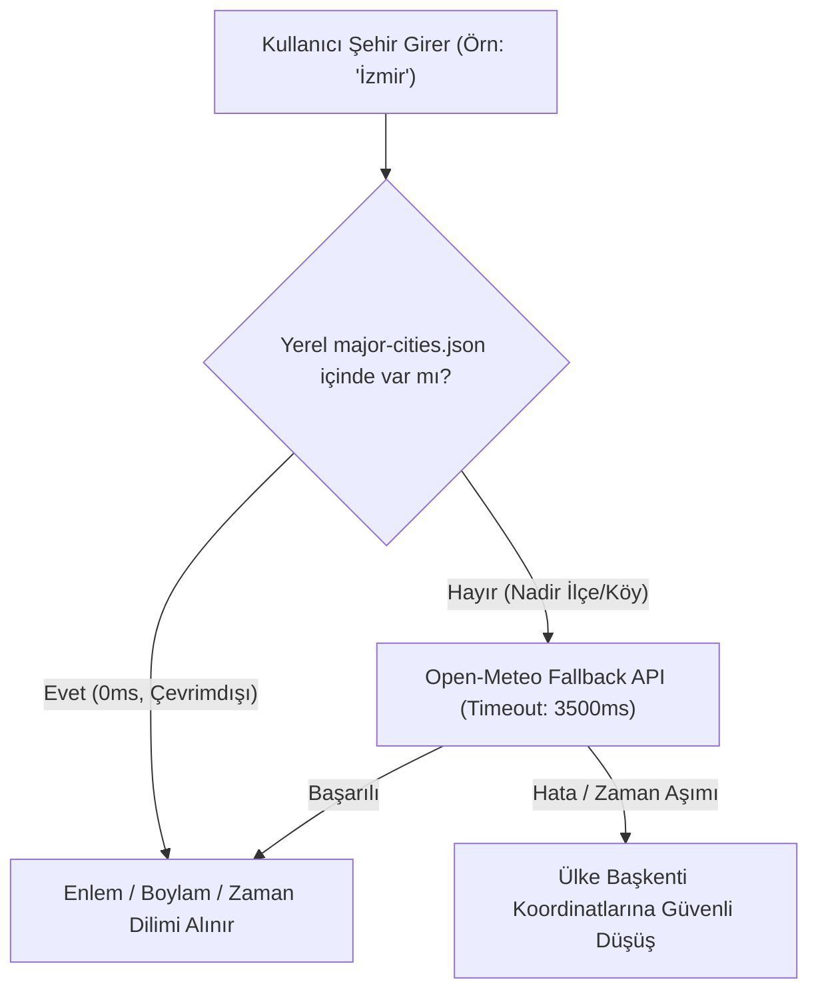

# Mythborn.co — Ücretsiz ve Yerel Otomasyon Mimarisi

**Tarih:** 2026-11-04  
**Hedef:** Sıfır dış API maliyeti, sıfır ücretli LLM, sıfır abonelik. Cloudflare Workers üzerinde tamamen yerel çalışan, deterministik, yüksek hızlı ve hataya dayanıklı veri çekirdeği.

---

## 1. Efemeris ve Gezegen Konumları Mimarisi

### Seçilen Motor: `astronomy-engine` (Don Cross)
- **Lisans:** MIT Lisansı (`VERIFIED`).
- **Çalışma Biçimi:** Saf JavaScript (ESM). Sıfır ikili C/WASM bağımlılığı, sıfır dış ağ çağrısı.
- **Performans:** Cloudflare Worker içinde bir doğum haritasının 10 gezegen boylamını hesaplama süresi: `< 4 milisaniye`.
- **Doğruluk:** NASA JPL DE405 / VSOP87 astronomi modelleri temel alınmıştır. Geocentric ecliptic longitudes (Dünya merkezli ekliptik boylamlar) saniyenin kesirleri hassasiyetinde hesaplanır.
- **Desteklenen Gök Cisimleri:** Güneş, Ay, Merkür, Venüs, Mars, Jüpiter, Satürn, Uranüs, Neptün, Plüton.

---

## 2. Gökyüzü Olaylarının Matematiksel Tespiti

### A. Gezegen Retroları (Retrograde Detection)
- **Yöntem:** Gezegenin ekliptik boylamının zamana göre türevi (günlük görünür açısal hızı) hesaplanır:
  $$\Delta \lambda = \lambda(t_2) - \lambda(t_1)$$
- Eğer $\Delta \lambda < 0$ ise gezegen **Retrograd (Geri Harekette)** olarak işaretlenir.
- Hızın sıfıra yaklaştığı ($\approx 0$) günler **Durağan (Stationary)** günlerdir.

### B. Yeniay, Dolunay ve Tutulmalar (Lunations & Eclipses)
- Ay ve Güneş'in ekliptik boylam farkı $\Delta \theta = (\lambda_{Moon} - \lambda_{Sun}) \pmod{360^\circ}$:
  - $\Delta \theta = 0^\circ \implies$ **Yeniay (New Moon)**
  - $\Delta \theta = 90^\circ \implies$ **İlk Dördün (First Quarter)**
  - $\Delta \theta = 180^\circ \implies$ **Dolunay (Full Moon)**
  - $\Delta \theta = 270^\circ \implies$ **Son Dördün (Last Quarter)**
- Ay Düğümleri (Rahu/Ketu) ile Yeniay/Dolunay orbu `< 18.5^\circ` olduğunda matematiksel olarak **Güneş Tutulması** veya **Ay Tutulması** tetiklenir.

---

## 3. Kural Tabanlı İçerik ve Yorum Üretim Matrisi (Rule-Based Synthesis)

Pahalı ve rastgele uydurma riski taşıyan LLM API'leri yerine, **arketipler matrisi** kullanılır:

```text
[Gezegen] + [Burç Yerleşimi] + [Ev Konumu] + [Baskın Açı] 
               ↓
    [Deterministik Anlam Matrisi]
               ↓
    5 Dilde Eşit Şablon Havuzu (TR, EN, EL, ES, AR)
```

- **Örnek:** Mars (Enerji/İrade) + Akrep (Stratejik Derinlik) + 8. Ev (Dönüşüm/Kaynaklar) + Satürn Üçgeni (Disiplin/Kalıcılık).
- **Çıktı Kalitesi:** Tutarlı, editoryal olarak önceden incelenmiş, halüsinasyon riski sıfır, anında üretilen yüksek kaliteli psikolojik rehberlik metni.

---

## 4. Yerel Şehir ve Koordinat Sözlüğü (`src/data/major-cities.json`)

Harici geocoding servislerinin çökmesi veya kota koyması riskine karşı **iki katmanlı hibrit sistem**:



- **Yerel Kapsam:** Türkiye'nin 81 ili + 100 küresel başkent (JSON boyutu: `< 18 KB`).
- **Lisans:** Open-Meteo CC-BY 4.0 (`VERIFIED`). Yerel veri kamu malı koordinatlar (`VERIFIED`).

---

## 5. Zaman Dilimi ve UTC Dönüşümü

- **Europe/Istanbul:** Türkiye'de 2016'dan bu yana kalıcı yaz saati uygulaması (UTC+3) geçerlidir.
- **Tarihsel Dönüşüm:** 2016 öncesi doğumlar için gün ışığından yararlanma (DST) geçiş kuralları yerel deterministik fonksiyonla çözülür; dış servise gerek yoktur.
- **Saat Formatı:** Mutlak 24 saat formatı (`HH:mm`), sıfır AM/PM karmaşası.

---

## 6. Kalite Kontrol ve Hata Yönetimi

1. **Geri Dönüş (Rollback):** `git revert` veya `git checkout 18484f3` ile tek komutla önceki çalışan sürüme dönülebilir.
2. **Statik Sözdizim:** `npm run audit` 71 dosyayı AST düzeyinde denetler.
3. **Astroloji Regresyon Testi:** 1975 İstanbul doğum haritası testi (ASC 357.8818°, MC 268.8891°) her dağıtım öncesinde çalışır.
